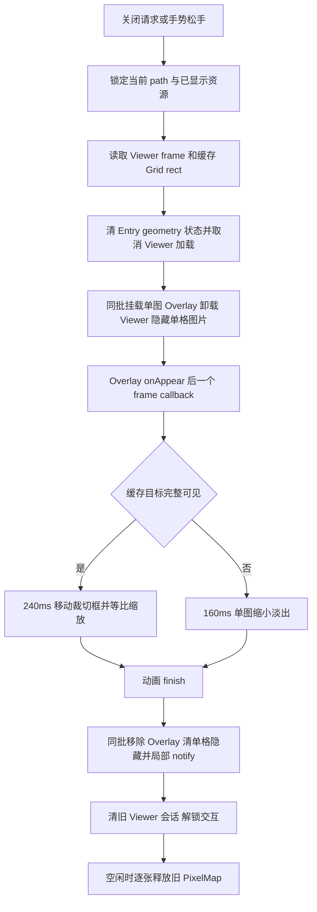

# Grid Viewer Return Overlay PoC — 2026-10-02

已构建并安装到 `192.168.0.142:44631`。普通 Grid 关闭使用独立单图 Overlay：松手后，返回格子的图片保持隐藏，飞行结束后恢复。Entry 的局部 notify 和两个 render frame 保留。

## A. 源码确认与实际改动

本轮运行时代码只修改 `entry/src/main/ets/pages/Index.ets`。接管前已有的 `FileEntry.ets`、`FileEntryDataSource.ets` 修改均保留。本报告是新增文件。

| 部分 | 接管时真实结构 / 本轮处理 |
| --- | --- |
| 页面根 | `Index.build()` 的 Stack；`main-file-content` 始终挂载。 |
| Grid | `GridFileList()` → Grid → LazyForEach → GridItem → 固定方形 Stack → GridThumbCell。key 仍为 `entry.path`。 |
| Viewer | `viewer-overlay-root` → ImageViewer 的 Stack → Swiper → LazyForEach → ViewerImagePage。Swiper `cachedCount(2)`，每页只有一个可显示 Image。 |
| 实验回滚 | `if (showImageViewer || viewerClosing)` 恢复为 `if (showImageViewer)`。确认 GridItem zIndex、opacity 实验已退出，并删除失效注释。 |
| Overlay 放置 | 页面根 Stack 内，作为 `main-file-content` 和 `viewer-overlay-root` 的兄弟，位于 Viewer 后，复用页面 Viewer 的层级 30。没有进入 Grid/GridItem/其裁切树。 |
| 显示资源 | `ViewerReturnSnapshot.source` 借用 `viewerImageSource(entry)` 返回的**当前显示** PixelMap/URI，同时固定其 orientation、fit。不主动换成尚未显示的 Original；关闭路径没有下载或 ImageKit decode。 |
| 起点 | `recordViewerFrameArea()` 缓存当前 Viewer frame 的实际布局矩形，加当前 zoom、dismiss scale 和 XY offset；未获得当前页回调时按现有 frame ratio 和 viewport 计算。 |
| 落点 | `ImageVisualState.thumbnailX/Y/Width/Height/VisibleRatio`，来自现有 `recordThumbnailArea/Visibility`。转换为 Viewer 层本地坐标。普通 Grid close 不调用 scrollTo、prepareViewerReturnSource 或全 Grid measure。 |
| 动画 | `ViewerReturnOverlay()` 只有一个固定尺寸 Image。外层裁切框移动、缩小，Image 作等比 scale，最终裁切成 Grid Cover 方形。 |
| 触摸 | Overlay 根使用 `HitTestMode.BLOCK_DESCENDANTS`，整棵纯绘制子树不参与触摸命中。底层 `main-file-content` 保持 Default，原 Viewer 的退场 Transparent 和空闲释放机制保留。 |
| 单格隐藏 | 私有 `viewerReturnHiddenPath` → `GridImageState.hidden` → GridThumbCell Image 的 `Visibility.Hidden`。布局和图片节点保留，且不承担 Exit geometry target。只 notify 当前 path。 |
| 生命周期 | `closeGridViewerWithReturnOverlay()` 同一批状态中挂载 Overlay、卸载真实 Viewer、隐藏返回图片。由 Overlay 的真实 onAppear 衔接一个 frame callback，再 animateTo。 |
| cleanup | finish 同批撤下 Overlay、清隐藏 path，再复用 `finishCloseImageViewer()` 的单格 notify、会话清理和空闲分片释放队列。活动持有检查增加 Overlay 对 PixelMap 的引用保护。 |
| 快速打开 | `runPendingOpenEntry()` 移到完整旧会话 cleanup 之后，避免新 open 的状态被随后的旧会话 reset 覆盖。 |

核心状态属于 Index：`viewerReturnOverlayVisible/X/Y/Width/Height/Scale/Opacity/BackdropOpacity`；资源和目标矩形在私有 `viewerReturnSnapshot`；私有 hidden path、mount resolve、token/generation 管理交接和取消。没有把动画状态写入 FileEntry，没有引入全局 bitmap epoch，没有更改 LazyForEach key。

A3 的 Original 驻留和邻页 Preview/磁盘预取代码未改。Overlay 不持有 Swiper 或邻页图片，资源最终仍进入已有 cleanup 队列。

## B. 实际 Exit 状态机

Grid PoC 不再调用 `startViewerExitTransition()`。其它现有入口的旧路径留在原位置，本轮没有大范围删除 geometry 代码。

## C. 真机验证

构建成功；保留原有 ArkTS 警告。安装成功，未卸载或清空应用数据。`git diff --check` 通过。

主要连续样本 24 次：普通关闭 8、拖动手势关闭 6、连续切换两张后关闭 4、Entry 过程中快速请求关闭 4、关闭后立即滑 Grid 2。

- 24 次打开均 `entry-source-bound`，`entry-fallback=0`；24 次返回均有效缓存目标，没有 target fallback。
- 每次关闭后的 UI dump 均有 `main-grid`，没有 `viewer-overlay-root` 或 `viewer-return-overlay`。
- 手势序列截图可见：返回目标图片在飞行期间隐藏，飞行图覆盖相邻 Grid 图片；结束后目标恢复。采样帧未见 Original + Thumbnail 双图或结束满屏闪。
- 关闭窗口内 `ImageViewerDiag: render layer=` 为 0，未复现旧实验的五个满屏 Viewer page 重渲染。
- 补充 6 次预热后关闭立即首滑，均无 Viewer/Overlay 残留，11 次 ScrollStop 扫描的 `scanNotified` 全部为 0。
- 再次重启应用后，对同图 First Open / Second Open 分别抓取动画中间帧，均有放大飞行动画；日志仍仅有原来的 frame1、frame2。

截图是阶段采样，不是连续高帧率录屏。因此不将“没有旧 Viewer 重渲染”扩展成整段动画没有任何卡顿的结论。动画尚未结束时再次点击重开的额外自动化没有获得有效的新 open 事件，未计入上述样本；排队重开仍需单独有效输入验证。

上述自动化“立即首滑”按脚本等待时间命名，HDC/uitest 调用延迟使它没有可靠覆盖动画结束后的 0～50ms。用户随后实际复现首划被吞，以下 F 节记录修复和人工输入证据；不能用前述自动化样本否定该回归。

## D. 性能

以下统计仅来自 24 次连续样本，起点为 Overlay close request。

| 指标 | 最小 | P50 | P95 | 最大 |
| --- | ---: | ---: | ---: | ---: |
| request → 实际 mounted | 14ms | 20ms | 39ms | 41ms |
| animation start → finish | 221ms | 237ms | 245ms | 245ms |
| request → 旧 Viewer 会话 closed | 263ms | 284ms | 329ms | 331ms |
| request → 单格局部重建恢复 | 271ms | 291ms | 336ms | 339ms |

关闭窗口内：Viewer page render **0**；ImageKit decode **0**；集中/分片 PixelMap release **0**。ArkUI `CreateImagePixelMap` 仍有 24 次，全部来自小尺寸 thumbnail cache URI，是返回格子正常图片节点的缩略图解码，不是新 Original decode。

按 trace `UIVsyncTask` 的同 vsyncID 区间合并口径，关闭窗口关联 86 个 UI 任务帧：`>16.67ms` 为 **5/86**，`>8.33ms` 为 **24/86**，P50 0.916ms，P95 17.568ms，最大 27.328ms。这是 UI 任务耗时口径，不等于系统实际呈现掉帧数量；性能不能报“零坏帧”。

主要样本第一次滚入未预热区间，ScrollStop `scanNotified` 为 **20、9**；同区域第二轮为 **0、0**。重启后的补充纯 Grid 滚动两轮均为 0，预热返回首滑也为 0。未修改 rendered-key 判据或兜底扫描，首次 20/9 的根因未单独证明。

## E. 剩余问题

1. 关闭窗口仍有上述 UI 长帧，收尾性能尚未完全验收。
2. 首次未预热滚动的 20/9 次补刷需要单变量定位；目前不能证明是 Overlay 回归，也不能忽略这组结果。
3. 动画中再次点击的排队重开需要补有效输入测试；本轮快速关闭样本已通过，但不等同于该场景。

没有扩展图片比例、metadata 或其它视图的重构。

## F. 返回首划回归修复

查到历史提交 `18ac8d1`（“消除首滑吞手势与250ms释放卡顿”）：底层 `main-file-content` 恒定 Default，退场 `viewer-overlay-root` 切 Transparent，位图释放放入交互避让的空闲队列。

新 ReturnOverlay 起初只有外层 `HitTestMode.None`。官方多层级手势指南及本机 SDK `enums.d.ts` 明确：None 仅排除自身，子节点仍参与命中。Overlay 中的全屏背景和 Image 仍可能截走紧接着开始的 Down；随后撤下节点不会把已开始的手势重新交给 Grid。

将 Overlay 根改为 `HitTestMode.BLOCK_DESCENDANTS`，排除整棵绘制子树的命中。没有更改飞行结束后才恢复缩略图的时机，没有加入额外等待或提前批量释放位图。

重新构建、安装成功。用户连续人工操作后明确反馈“首划已恢复正常”。同时采集到 7 个完整的 `PreDispatchDown → ChildDown → ScrollStart` 会话；另有 2 个会话直接记录 ScrollStart，因 Down 开始时诊断窗口尚未开启，不计为完整链。最早完整样本为 session 14：动画结束后 **24ms** 收到 Down，**25ms** 到达 Grid，**41ms** 开始滚动；命中候选中仍有尚未撤下的 ReturnOverlay，Grid 仍收到同一指针。

仅有 Down 的会话可能是点击，不将其判为滑动失败。此前 uinput 参数无效的自动化尝试未计入验证。此次没有重跑性能 trace，D 节性能数据仍属于修改前的 24 次样本。

安装 HAP SHA256：`3308abcf67e82c28802994bc4f6c2b948e9298cabee48c44ed1e41f120935a90`。

## 证据位置

本机工程下 `artifacts/return-overlay/` 保存：

- `Index.before.ets`、`Index.baseline.ets`、`Index.overlay.ets`、`change.diff`：接管状态、回滚基线和本轮精确修改。
- `build-final.log`、`install-final.log`、`hashes.json`：构建、安装、源文件和 HAP 的 SHA256。
- `benchmark-hilog.log`、`benchmark.ftrace`、`cases.json`、`metrics.json`、`analyze_evidence.py`：24 次连续样本及分析口径。
- `gesture-*.jpeg`、`gesture-hilog.log`：松手返回、飞行单格隐藏和结束恢复。
- `first-entry-*.jpeg`、`second-entry-*.jpeg`、`entry-visual-hilog.log`：First/Second Open 中间帧。
- `warm-cases.json`、`warm-return-*.log`、`pure-grid-*.log`：补充首滑和纯 Grid 观察。
- `Index.first-swipe.ets`、`build-first-swipe.log`、`install-first-swipe.log`、`manual-first-swipe-input-hilog.log`、`manual-first-swipe-metrics.json`：首划修复源码、构建安装和用户人工输入证据。

`artifacts/` 已在工程原有 .gitignore 中；未提交签名材料或设备截图。
